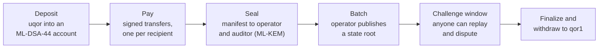
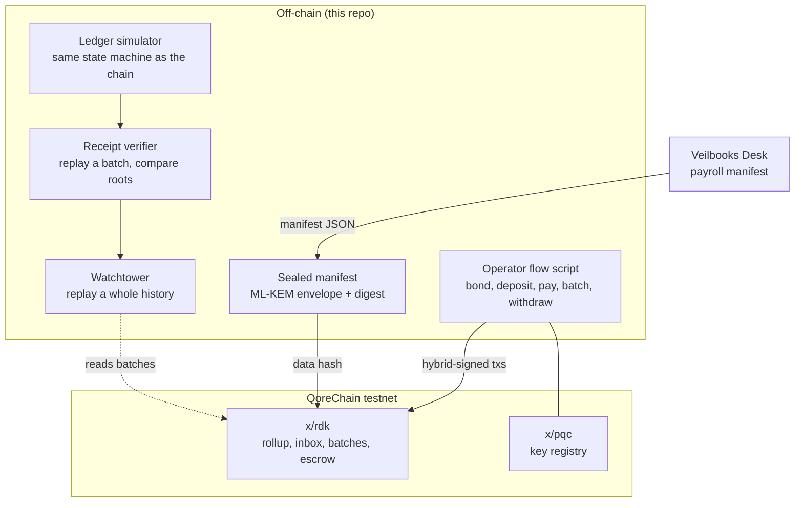

<h1 align="center">Veilbooks Rail</h1>

<p align="center">
  <b>The quantum-safe settlement rail for private business payments.</b><br>
  A payroll run settles on QoreChain without exposing who got paid or how much.
</p>

<p align="center">
  
  
  
  
  
</p>

<p align="center">
  <a href="THREAT_MODEL.md">Threat model</a> ·
  <a href="#live-testnet-run">Live testnet run</a> ·
  <a href="#quick-start">Quick start</a> ·
  <a href="AI_USAGE.md">AI use</a>
</p>

---

## Contents

- [Overview](#overview)
- [The problem](#the-problem)
- [How it works](#how-it-works)
- [Architecture](#architecture)
- [Features](#features)
- [Live testnet run](#live-testnet-run)
- [Quick start](#quick-start)
- [Commands](#commands)
- [Browser page](#browser-page)
- [Security](#security)
- [Project structure](#project-structure)
- [Configuration](#configuration)
- [Limitations](#limitations)
- [The Veilbooks suite](#the-veilbooks-suite)

## Overview

Veilbooks Rail is an **optimistic rollup on QoreChain** that uses the `qledger-v1` execution model. Accounts are controlled by post-quantum **ML-DSA-44** keys. Payments are batched and settled with verifiable state roots. Each payment run is described by a **manifest** that is sealed with **ML-KEM-1024**, so only the operator and a named auditor can read it.

It is built for the QoreChain "Build Before Q-Day" developer fest, in the **Protocol Builders** track.

## The problem

Businesses pay people in bulk: payroll, suppliers, contractors. On a public chain every amount and recipient is visible to everyone, which is not acceptable for salaries. Signatures that protect those payments today are also expected to break once large quantum computers exist, and records posted now can be kept and attacked later.

Rail keeps the amounts private, signs with post-quantum keys, and still lets anyone check that the operator settled the batch honestly.

## How it works



1. A company **deposits** uqor into an ML-DSA-44 account on the rollup.
2. A payment run is a set of **signed transfers**, one per recipient, posted to the rollup inbox.
3. The run's **manifest** is sealed to the operator and the auditor. Only its digest is public.
4. The operator submits a **batch** with a state root. Anyone can re-execute the batch with the receipt verifier. A mismatch is a challenge during the window.
5. After the window the batch is **finalized**, and recipients **withdraw** to their `qor1` addresses.

## Architecture



| Piece | What it does | Where |
| --- | --- | --- |
| Ledger simulator | Runs deposits, transfers and withdrawals exactly as the chain re-executes them | `rollup/src/sim.ts` |
| Sealed manifest | Encrypts a payment run to named members and returns a digest and a data hash | `rollup/src/manifest.ts` |
| Receipt verifier | Re-executes a batch from the previous ledger and compares state and withdrawal roots | `rollup/src/receipt.ts` |
| Watchtower | Replays a history in order and builds a challenge for the first bad batch | `rollup/src/watchtower.ts` |
| Operator flow | Bond, deposit, pay, withdraw, batch and execute on the testnet | `rollup/src/flow.ts` |

## Features

- **Deposit, transfer and withdraw** in uqor between ML-DSA-44 accounts.
- **Local simulator** of the state machine, so a batch can be checked before fees are spent.
- **Sealed payment manifests** for the operator and an auditor, committed by digest. The amounts do not appear in the envelope bytes.
- **Batch receipt verifier** that catches a forged root, a wrong parent, a dropped entry and a replayed batch.
- **Watchtower** that replays a history in order and raises a challenge with the roots the operator should have published.
- **Manifest import** from Veilbooks Desk, with validation (unique ids, valid payees, positive whole amounts).
- **Live testnet flow** with transaction hashes recorded below.
- **Threat model** tied to the test suite, marking each claim tested, by design or planned.

## Live testnet run

The full flow has run on the QoreChain testnet (`qorechain-diana`). The rollup `veilbooks-rail` is `active`, and batch 0 is `finalized`.

| Step | Result | Transaction |
| --- | --- | --- |
| Bond submitter (1,000 QOR) | done | `94AD97EC68833F7D0FBD323E9A74DE00F21F0FAB9C45265C85C000AC2DA7348B` |
| Deposit 100 QOR | done | `880AB1CBD4CEC98336BAA60419E351C735E5C920DAD0694F8CD3FEF71EC057E6` |
| Transfer 20 QOR | done | `2A0769C7B4276C9CD4F2B09F67378F416CBB56C3E3CB487348297438E7207C52` |
| Transfer 30 QOR | done | `E7821FC9759E8E5F5117E229B00E208447E7238C451CB2907DA9ADE0D12B167E` |
| Submit batch 0 (3 entries) | finalized | `4A6FE51A66D5B0652C7E035BFC41A1850F0E2CF2D484E55A8125AAAF0C79D6B1` |
| Post a 5 QOR withdrawal | done | `61296DBD2BED5F70B89CE73146FFA95DFAE7DFA89C39B9C89F2965DFF985AA62` |
| Submit batch 1 (carries the withdrawal) | in its challenge window | `95FB7D680E9581B3AEB9BDA6218B3021DC773286257BDE63404281241D78A388` |

The state root on chain for batch 0, `9bff8066cc904e14819cdcd25adad126e0994593d489361b553a2111a9b9af6d`, matches the root computed locally. Executing the withdrawal comes after batch 1 finalizes.

## Quick start

Requires Node.js 20 or newer. No network or funds are needed for the demo.

```sh
cd rollup
npm install
npm test        # ledger, attack cases, sealed manifest, receipt verifier, watchtower
npm run demo    # deposit, payroll run, sealed manifest, honest and forged batches
npm run judge   # watchtower replays a history: 5 attacks and 1 control
```

## Commands

| Command | What it does |
| --- | --- |
| `npm run demo` | Offline walk-through of a payroll run |
| `npm run judge` | Watchtower attack checks, exits non-zero on any failure |
| `npm run seal-manifest -- run.json` | Seals a manifest exported from Desk and prints the digest and data hash |
| `npm run doctor` | Preflight checks for the testnet (network, key, balance) |
| `npm run status` | Rollup health and the latest batch |
| `npm run flow -- bond` | Bond the submitter |
| `npm run flow -- deposit <QOR>` | Deposit into the payer account |
| `npm run flow -- pay <name> <QOR>` | Post a signed transfer |
| `npm run flow -- withdraw <name> <QOR>` | Post a signed withdrawal to the operator address |
| `npm run flow -- batch` | Plan and submit a batch |
| `npm run flow -- execute <batch> [i]` | Execute a finalized withdrawal with its proof |

## Browser page

`web/` is a small Vite + React page for judges. It reads the live rollup and its batches from the chain, checks that each batch starts from the previous batch's state root, and runs the six watchtower scenarios in the browser.

```sh
cd web
npm install
npm run dev
```

The testnet sends no CORS headers, so the page reads the chain through `/chain/*` on its own origin (a proxy in development, a rewrite in `vercel.json` in production).

## Security

[THREAT_MODEL.md](THREAT_MODEL.md) lists each attacker, what stops them, and whether the claim is covered by a test.

| Attack | Result |
| --- | --- |
| Replay a signed transfer | No effect (nonce already used) |
| Edit or bit-flip a signed transfer | Refused |
| Overspend, or reuse a nonce | No effect |
| Spend with a stolen classical key | Not possible: rollup accounts only accept ML-DSA-44 |
| Forged state root, wrong parent, dropped entry | Caught by the receipt verifier and the watchtower |
| Replayed or skipped batch | Caught by the watchtower |
| Read a manifest without being a member | Refused |
| Read amounts from the posted data | Only an opaque ML-KEM envelope is posted |

## Project structure

```
veilbooks-rail/
├── rollup/
│   ├── rollup.config.ts      rollup configuration (optimistic, based sequencing, qledger-v1)
│   ├── src/
│   │   ├── sim.ts            ledger simulator
│   │   ├── manifest.ts       sealed payment manifests and parser
│   │   ├── receipt.ts        batch receipt verifier
│   │   ├── watchtower.ts     history replay and challenges
│   │   ├── scenarios.ts      honest history and attacks
│   │   ├── flow.ts           on-chain operator flow
│   │   └── demo.ts, judge.ts, seal-manifest.ts, doctor.ts, status.ts
│   └── test/                 sim, manifest, receipt and watchtower tests
├── web/                      browser page (Vite + React)
├── THREAT_MODEL.md
└── AI_USAGE.md
```

## Configuration

Copy `rollup/.env.example` to `rollup/.env` and set `QORE_MNEMONIC` (or `QORE_OPERATOR_PRIVATE_KEY_HEX` with `QORE_PQC_SEED_HEX`). Use a testnet-only key. `.env` and `.accounts.json` are git-ignored: never commit them.

## Limitations

- The rollup moves **uqor only**, and its only account scheme is **ML-DSA-44**.
- A **single operator** submits batches. Forced exit through the inbox is planned, not built.
- Posting a challenge on chain is **planned**. The watchtower builds the challenge but does not send it.
- Poster addresses, post sizes and timing are public.
- Anyone in a manifest's member list can read the whole manifest, including the auditor.
- All keys and funds are for the testnet.

## The Veilbooks suite

| Repository | Role |
| --- | --- |
| [veilbooks-rail](https://github.com/ayushsingh82/veilbooks-rail) | Settlement rollup for private business payments |
| [veilbooks-desk](https://github.com/ayushsingh82/veilbooks-desk) | Sealed invoices and payroll for people and auditors |
| [veilbooks-steward](https://github.com/ayushsingh82/veilbooks-steward) | Agent that pays invoices within limits the owner signed |
| [veilbooks-core](https://github.com/ayushsingh82/veilbooks-core) | Shared library: sealing, commitments, key registration |

## Licence and AI use

Apache-2.0. See [AI_USAGE.md](AI_USAGE.md) for how AI tools were used.
